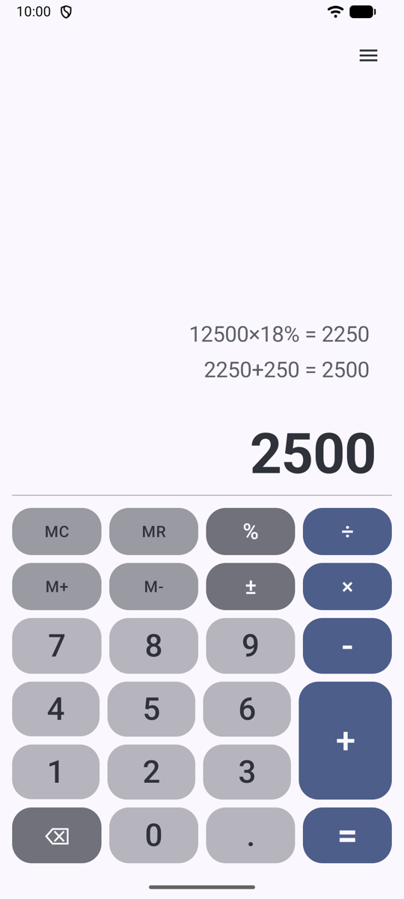
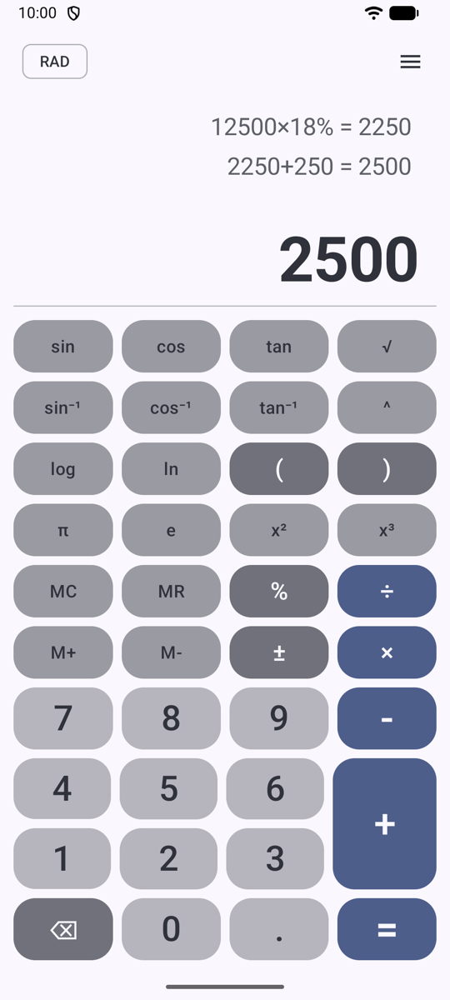
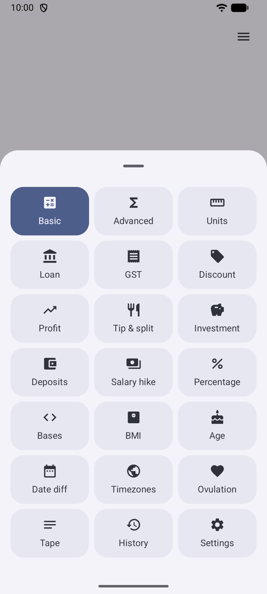
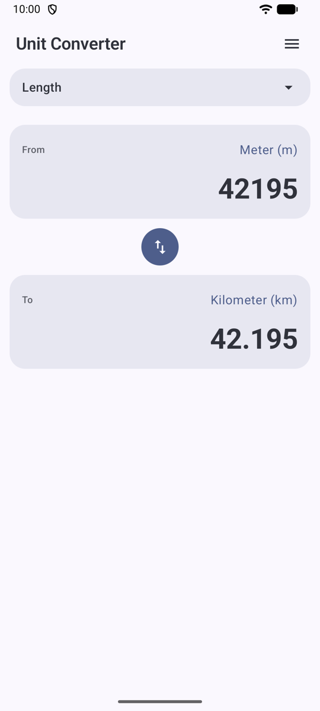
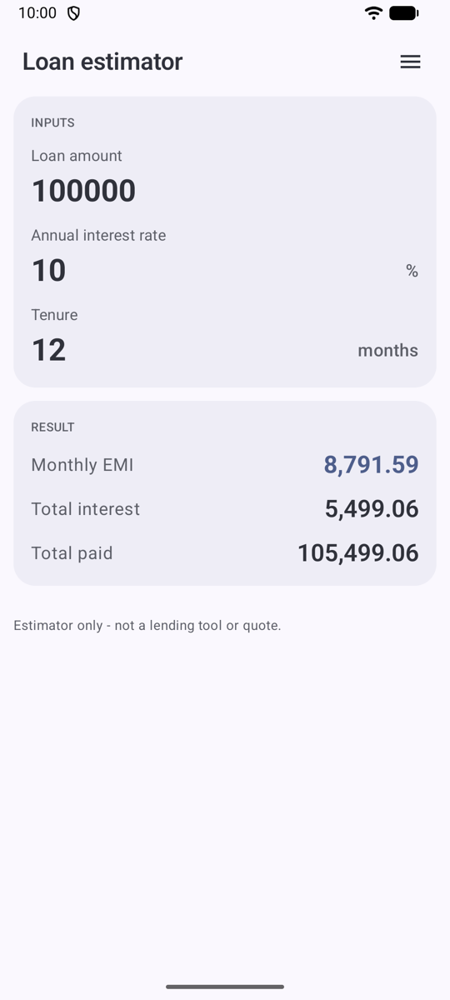
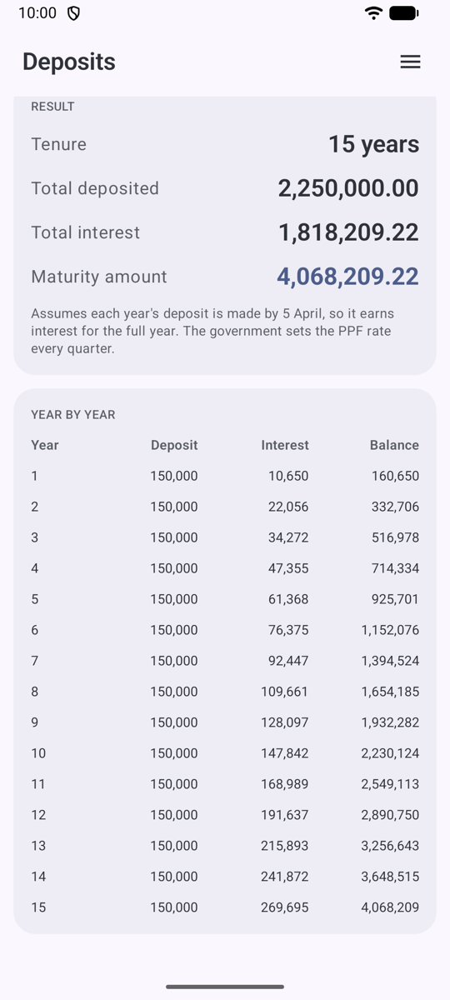
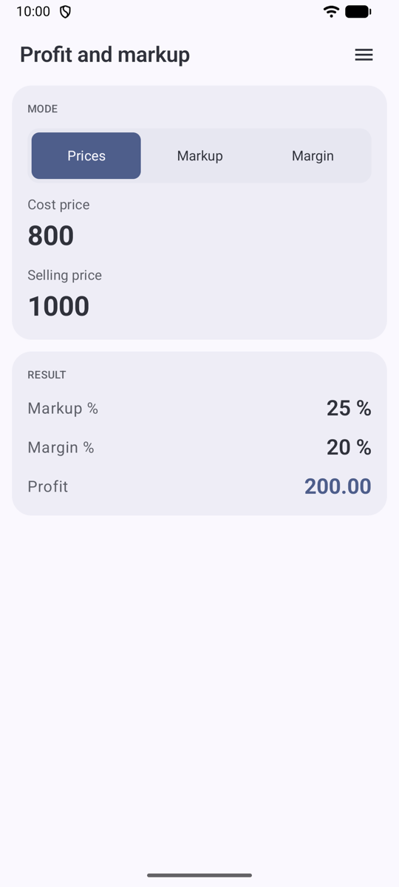
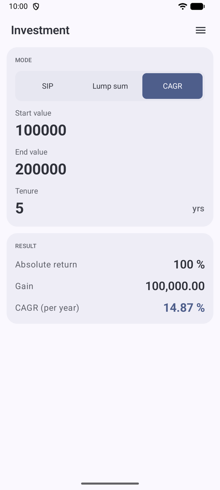

# Calculator

A modern, fully-offline, multi-purpose calculator for Android - inspired by Mi Calculator, built with Kotlin and Jetpack Compose.

<a href="https://play.google.com/store/apps/details?id=in.co.gorest.calculator"></a>

> Status: **v1** - live on [Google Play](https://play.google.com/store/apps/details?id=in.co.gorest.calculator). See [CHANGELOG.md](CHANGELOG.md) for releases and [REQUIREMENTS.md](REQUIREMENTS.md) for the full product spec.

## Screenshots

The images follow your GitHub theme: light or dark.

<table>
  <tr>
    <td align="center"><picture><source media="(prefers-color-scheme: dark)" srcset="assets/screenshots/dark/basic.png"></picture><br>Basic</td>
    <td align="center"><picture><source media="(prefers-color-scheme: dark)" srcset="assets/screenshots/dark/advanced.png"></picture><br>Scientific</td>
    <td align="center"><picture><source media="(prefers-color-scheme: dark)" srcset="assets/screenshots/dark/tools.png"></picture><br>Tools menu</td>
    <td align="center"><picture><source media="(prefers-color-scheme: dark)" srcset="assets/screenshots/dark/units.png"></picture><br>Unit converter</td>
  </tr>
  <tr>
    <td align="center"><picture><source media="(prefers-color-scheme: dark)" srcset="assets/screenshots/dark/loan.png"></picture><br>Loan EMI</td>
    <td align="center"><picture><source media="(prefers-color-scheme: dark)" srcset="assets/screenshots/dark/deposits.png"></picture><br>FD, RD and PPF</td>
    <td align="center"><picture><source media="(prefers-color-scheme: dark)" srcset="assets/screenshots/dark/profit.png"></picture><br>Profit and markup</td>
    <td align="center"><picture><source media="(prefers-color-scheme: dark)" srcset="assets/screenshots/dark/cagr.png"></picture><br>Investment CAGR</td>
  </tr>
</table>

## Features

- Basic and scientific calculator with editable history and a running tape view
- Percentage calculator
- Unit converter (length, area, volume, mass, temperature, speed, time, data, pressure, energy, power) plus a number-base converter
- Finance calculators: Loan/EMI, GST (India), Discount, Profit and markup, Investment with CAGR, FD/RD/PPF deposits (India), Salary hike, Tip split
- Health calculators: BMI, Ovulation
- Date & time calculators: Age, Date difference, Timezone converter
- Floating overlay calculator (draw-over-other-apps) and a home-screen widget (Jetpack Glance)
- Material 3 + Material 3 Expressive UI, Material You dynamic color, light/dark themes
- **Fully offline** - no network calls, no analytics, no ads

## Tech stack

| Area | Choice |
|---|---|
| Language | Kotlin 2.x |
| Min SDK | API 31 (Android 12) |
| Target SDK | API 36 (Android 16) |
| UI | Jetpack Compose, Material 3 (with Expressive components) |
| Architecture | MVVM, single-activity, unidirectional data flow |
| DI | Hilt |
| Async | Coroutines + Flow |
| Persistence | Room + DataStore |
| Network | None - fully offline, no network calls |
| Widgets | Jetpack Glance |
| Build | Gradle Kotlin DSL, Version Catalogs |
| Testing | JUnit5 (unit), JUnit4 + AndroidX Test + Compose UI Test, Turbine, MockK, Robolectric, Kotest (property tests) |
| CI | GitHub Actions |

## Project layout

Everything ships from a single Gradle module (`:app`); `feature/` and `core/` are Kotlin packages.

```
app/
  src/main/java/com/calculator/
    feature/        # User-facing features: basic, math, converter, finance,
                    #   health, datetime, history, tape, floating, settings
    core/
      math/         # Expression parser + evaluator (pure Kotlin, no Android deps)
      designsystem/ # Theme, colors, typography, shared Compose components
      data/         # Room + DataStore
      domain/       # Cross-feature use-cases (pure Kotlin)
      common/       # Utilities, formatters, locale helpers
      widget/       # Glance home-screen widget + Quick Settings tile
    navigation/     # Type-safe Navigation Compose host
    CalculatorApplication.kt
    MainActivity.kt
```

## Getting started

### Prerequisites

- **Android SDK Platform 37** (compileSdk 37, targetSdk 36, minSdk 31)
- **Android Studio** - a version that supports Android Gradle Plugin 9.4 (see [Android Studio releases](https://developer.android.com/studio/releases))
- **JDK 21** to run Gradle (`gradle/gradle-daemon-jvm.properties` asks for 21). The JDK bundled with Android Studio works. The build downloads JDK 17 for compiling through the Foojay toolchain resolver.

The project uses Android Gradle Plugin 9.4.1 and Gradle 9.8.1. The Gradle wrapper is checked in; use `./gradlew` and never regenerate it.

### First-time setup

```bash
# Clone
git clone https://github.com/YOUR_USERNAME/calculator.git
cd calculator

# Build the debug APK (the Gradle wrapper is checked in)
./gradlew :app:assembleDebug

# Install on a connected device or emulator
./gradlew :app:installDebug

# Run unit and Compose UI tests (JVM, no emulator needed)
./gradlew test

# Static analysis
./gradlew detekt ktlintCheck lint
```

### Opening in Android Studio

1. **File → Open** and select the project root.
2. Android Studio will sync Gradle and download dependencies.
3. Select the `app` run configuration and press Run.

## Contributing

We welcome contributions of any size. See [CONTRIBUTING.md](CONTRIBUTING.md) for the workflow, coding style, and how to run the test/lint suite locally before opening a pull request.

## License

Licensed under the Apache License, Version 2.0. See [LICENSE](LICENSE) for the full text.

---

*This project is not affiliated with, endorsed by, or sponsored by Xiaomi Inc. "Mi Calculator" is referenced only as design inspiration.*
